  

# Awesome Contract Portfolio Risk & Value Monitoring 

> 📑 A curated directory of enterprise SaaS solutions and open-source tools for portfolio-wide contract risk management, financial value leakage prevention, compliance tracking, and obligation intelligence.

Contract Portfolio Risk and Value Monitoring empowers legal operations, procurement, governance, risk, and compliance (GRC), and corporate finance teams to evaluate contractual relationships holistically across their entire contract repository. Rather than inspecting one contract at a time, these platforms ingest thousands of agreements simultaneously to detect high-risk liability exposure, price escalations, non-standard clause deviations, missed renewal windows, and unfulfilled performance obligations. 🔍💡

---

## 📑 Table of Contents
- [📊 Sector Overview & Market Dynamics](#-sector-overview--market-dynamics)
- [🏢 Enterprise SaaS Platforms](#-enterprise-saas-platforms)
- [💻 Open-Source Projects](#-open-source-projects)
- [🏗️ Key Architectural Patterns](#️-key-architectural-patterns)
- [🤝 Contributing](#-contributing)
- [💖 Support & Community](#-support--community)
- [⭐ Star History](#-star-history)
- [⚖️ Disclaimer](#️-disclaimer)

---

## 📊 Sector Overview & Market Dynamics

The global Contract Lifecycle Management (CLM) and contract analytics market is valued between **$1.8B and $3.2B** (projected to exceed **$4.5B to $5.4B** into the mid-2030s at an ~11–13% CAGR). The market structure is **moderately fragmented across point solutions and legacy GRC frameworks**, but is experiencing **accelerated consolidation** toward dominant enterprise platforms driven by private equity rollups, generative AI platform additions, and major tech acquisitions (e.g., Workday acquiring Evisort, DocuSign acquiring Lexion, Haveli acquiring Sirion). 📈🚀

---

## 🏢 Enterprise SaaS Platforms

The table below lists leading commercial contract intelligence, portfolio risk assessment, and enterprise GRC platforms. Entries are sorted in descending order by **Company Size (Revenue / Enterprise Valuation)**.

| Product | Company Size (Revenue / Valuation) | Description | Starting Pricing | Free Tier / Trial Limits |
|:---|:---|:---|:---|:---|
| **[Diligent HighBond](https://www.diligent.com/)** | **~$600M+ ARR** / ~$1.5B+ Valuation | Enterprise GRC & Third-Party Risk platform monitoring KRIs, KCIs, and automated risk scoring thresholds across third-party agreements and registers. | **$23,488 / year** median annual contract ($5,000–$50,000+ implementation) | **0 days**; No free tier or trial (paid pilots and sales-led live demos only) |
| **[Icertis (Vera Analytics)](https://www.icertis.com/)** | **~$300M+ ARR** / ~$2.8B–$5.0B Valuation | AI-powered enterprise contract portfolio intelligence with Knowledge Graph clause linking, semantic search, and supplier price escalation monitoring. | **$88,000 / year** baseline contract (~$1,500/user/year minimum deployment) | **0 days**; No free tier or trial (sales-assisted guided sandbox demos only) |
| **[MetricStream](https://www.metricstream.com/)** | **~$140M–$310M ARR** / ~$500M+ Valuation | Third-Party Risk Management (TPRM) suite tracking vendor KPIs, SLA breaches, assessment scoring, and portfolio risk postures. | **$75,000 / year** starting annual subscription | **0 days**; No free tier or trial (structured sales proofs-of-concept only) |
| **[Sirion](https://www.sirion.ai/)** | **~$40M–$60M ARR** / ~$1.0B Valuation | AI-native contract analytics platform mining contract corpora for missing clauses, liability caps, obligation gaps, and counterparty risks via AskSirion. | **$1,500 / user / year** starting baseline via enterprise app exchange | **0 days**; No free tier or trial (custom proof-of-value sandbox by invitation) |
| **[LogicGate Risk Cloud](https://www.logicgate.com/)** | **~$49M Revenue** / ~$160M+ Raised | No-code GRC application centralizing vendor contracts, renewal pipelines, SLA performance metrics, and compliance breaches. | **$25,000 / year** starting base fee (includes unlimited standard users; charges per application & Power User) | **0 days**; No free tier or trial (vendor-guided live demonstration upon request) |
| **[Luminance](https://www.luminance.com/)** | **~$30M–$60M ARR** / ~$400M Valuation | Legal-grade proprietary LLM surfacing portfolio-wide trends in payment terms, liability caps, upcoming renewals, and commercial commitments. | **$50,000 / year** starting deployment tier | **0 days**; No free tier or trial (enterprise pilot after technical discovery) |
| **[Evisort (Workday)](https://www.evisort.com/)** | **~$30M ARR** / ~$250M–$300M Acquisition | Contract intelligence platform featuring 120+ pre-built machine learning models for clause anomaly detection, risk flags, and portfolio extraction. | **$30,000 / year** starting team tier ($60,000–$120,000/yr mid-market) | **0 days**; No free tier or trial (guided sales evaluation following Workday integration) |
| **[CobbleStone](https://www.cobblestonesoftware.com/)** | **~$25M–$27M Revenue** / Bootstrapped-to-Growth | Contract Insight CLM powered by VISDOM AI for obligation governance, renewal pipeline analysis, and Power BI / Tableau dashboard synchronization. | **$40 / user / month** ($480/user/year, starting 5-user pack ~$1,935/year) | **0 days**; No free tier or trial (guided 30-minute interactive product tour) |

---

## 💻 Open-Source Projects

Self-hosted, developer-friendly, and open-source tools for building automated contract risk analysis pipelines, contract obligation tracking, and legal AI workflows. Entries are sorted in descending order by **GitHub_Stars**.

| Repository | GitHub_Stars | Description | Focus Area |
|:---|:---:|:---|:---|
| **[anthropics/claude-for-legal](https://github.com/anthropics/claude-for-legal)** |  | Official suite of plugins, prompt templates, and evaluation pipelines for legal contract review, clause anomaly extraction, and risk auditing. | ⚖️ Legal AI & Prompt Workflows |
| **[open-legal-products/mike](https://github.com/open-legal-products/mike)** |  | Open-source enterprise legal AI platform providing document intelligence, automated contract analysis, clause extraction, and self-hosted workflows. | 📄 Legal Document Intelligence |
| **[zubair-trabzada/ai-legal-claude](https://github.com/zubair-trabzada/ai-legal-claude)** |  | Multi-agent autonomous legal assistant orchestrating contract risk analysis, obligation review, redlining, and compliance audit reporting. | 🤖 Autonomous Multi-Agent Review |
| **[jhpyle/docassemble](https://github.com/jhpyle/docassemble)** |  | Production-grade open-source platform for guided legal document automation, obligation interview modeling, and rule-based compliance workflows. | 📑 Document Automation & Compliance |
| **[evolsb/claude-legal-skill](https://github.com/evolsb/claude-legal-skill)** |  | Contract review engine trained with Atticus Project CUAD risk detection, market benchmarks, and automated lawyer-ready redlining. | 🎯 CUAD Risk Detection & Redlining |
| **[neo4j-product-examples/graphrag-contract-review](https://github.com/neo4j-product-examples/graphrag-contract-review)** |  | Knowledge Graph RAG agent designed to map inter-contract dependencies, party obligations, and systemic legal exposure across contract portfolios. | 🕸️ GraphRAG Portfolio Analysis |
| **[vikashjeyaraman/opencouncil-contract-inspector](https://github.com/vikashjeyaraman/opencouncil-contract-inspector)** |  | Multi-agent AI contract review framework applying verdict-driven quality control, risk clause scoring, and negotiation benchmark checks. | 🛡️ Multi-Agent Risk Inspection |
| **[Lethe044/hermes-legal](https://github.com/Lethe044/hermes-legal)** |  | Open-source CLI for batch contract portfolio risk aggregation, deadline tracking, counterparty risk distribution, and webhook-based alerting. | ⏱️ Batch Risk & Deadline Monitoring |
| **[AniketTati/draft-legal](https://github.com/AniketTati/draft-legal)** |  | Self-hosted AI-native CLM alternative with hybrid retrieval (pgvector + Elasticsearch + RRF) for portfolio-wide question answering and risk scoring. | 🏠 Self-Hosted AI CLM |
| **[aaked-app/aakd](https://github.com/aaked-app/aakd)** |  | Open-source contract operations workspace featuring structured obligation and renewal schedules, audit history, and page-level evidence citation. | 📌 Contract Operations & Tracking |
| **[open-contracting/kingfisher-process](https://github.com/open-contracting/kingfisher-process)** |  | Data ingestion and transformation pipeline mapping procurement and public contract datasets to the Open Contracting Data Standard (OCDS). | 🏛️ Public Procurement Analytics |
| **[jkboamah/complianceforge](https://github.com/jkboamah/complianceforge)** |  | GRC reference framework providing data models for enterprise risk registers, vendor assessment matrices, and KRI dashboard tracking. | 🗂️ GRC Risk Register Reference |

---

## 🏗️ Key Architectural Patterns

For engineering teams constructing internal contract portfolio monitoring pipelines:
1. 📥 **Clause Ingestion & Extraction**: Ingest PDFs/DOCX via OCR and layout-aware parsers, extracting normalized clause entities (indemnification, liability caps, termination convenience, renewal notice windows).
2. 🔄 **Hybrid RAG & Knowledge Graphs**: Combine dense vector retrieval (pgvector) with keyword search (Elasticsearch/BM25) or GraphRAG (Neo4j) to understand relationship graphs between master service agreements (MSAs), statements of work (SOWs), amendments, and SLAs.
3. 🧮 **Risk Scoring Engine**: Apply rule-based scoring (e.g., notice period < 30 days, uncapped liability) paired with LLM-based playbooks to calculate aggregated portfolio risk exposure.
4. 📊 **BI & Analytics Visualizations**: Stream structured risk parameters to Metabase, Apache Superset, or Tableau for real-time executive visibility and value-leakage alerts.

---

## 🤝 Contributing

Contributions and additions are welcome! 🙌
1. 🍴 Fork this repository.
2. 📝 Add your tool to the appropriate table following the formatting standards (including specific pricing, exact free tier limits, company revenue/valuation, or GitHub_Stars_Badge).
3. 🚀 Submit a Pull Request with a clear description of the platform or project.

---

## 💖 Support & Community

Thank you for visiting and using this project! If you find this curated ecosystem directory helpful:
- ⭐ **Star this repository** to show your support and make it easier for others to discover!
- 🍴 **Fork and contribute** by adding new tools, frameworks, and insights.
- 📢 **Share it** with fellow legal ops specialists, contract managers, risk leads, and developers!
- ☕ **Buy a coffee & sponsor**: If you would like to support ongoing maintenance and new open-source initiatives, consider sponsoring via the [GitHub Sponsors Dashboard](https://github.com/sponsors/ishandutta2007).

---

## ⭐ Star History

---

## ⚖️ Disclaimer

This repository is curated for informational and educational purposes. Product pricing, trial policies, and corporate valuations represent public and market intelligence estimates gathered through industry benchmarks and may vary based on procurement scope. No legal or investment advice is provided.
